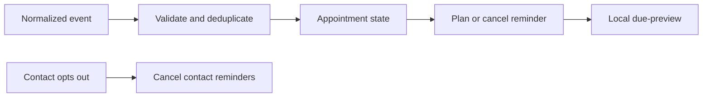

# GHL Appointment Workflow Lab

A **local appointment-workflow simulator** designed to practise the business rules
behind GoHighLevel booking and follow-up automations. Original portfolio lab by
Anees Ur Rehman. Not a native GHL snapshot, live integration, or client deployment.

## Run (Python 3.11+, no dependencies)

```sh
python scripts/verify.py
python -m appointment_lab --db demo.sqlite replay examples/events.json
python -m appointment_lab --db demo.sqlite snapshot
python -m appointment_lab --db demo.sqlite due 2026-10-27T07:30:00Z
```

The synthetic demo books, reschedules, replays a duplicate event and opts out. It
preserves an event history, cancels the earlier reminder and suppresses remaining
follow-ups. See [demo results](evaluation/demo.json) and [tests](evaluation/tests.txt).
No external account is accessed and no email, SMS or WhatsApp message is sent.

## Demonstrated behavior

- Transactional SQLite state and event-ID deduplication.
- Rejects a reused event ID with different content.
- Cancels obsolete reminders on reschedule/cancellation/completion/no-show.
- Contact-level opt-out suppresses all its appointments within the same location.
- Timezone-aware timestamps, UTC reminder planning, and no reminder after start time.
- Monotonic sequence checks ignore stale events; terminal states reject rescheduling.
- Due reminders are previews only, not delivered-message claims.



## Bridge to GoHighLevel

See [native workflow blueprint](docs/GHL-BLUEPRINT.md). This normalized event schema
is our own contract, **not the raw HighLevel webhook format**. An integration must
verify event signatures, map identifiers and event types, retrieve current appointment
state, and resolve ordering. The per-appointment sequence must come from a trusted
adapter; this lab does not assume GHL supplies such a sequence field.

The lab uses contact-wide suppression; real GHL DND may be per-channel. No opt-in
restoration is implemented. It does not implement funnels, a calendar UI, live
opportunity updates, rebooking campaigns, quiet hours, native workflow import/export,
OAuth or webhook verification. These are follow-on account exercises, not completed
features. Files are not encrypted; use synthetic data only.

## References

- [HighLevel contacts API and duplicate handling](https://marketplace.gohighlevel.com/docs/ghl/contacts/contacts/index.html)
- [HighLevel contact workspace and DND](https://help.gohighlevel.com/support/solutions/articles/155000006651)

No affiliation with HighLevel. MIT-licensed original code and synthetic fixtures.
